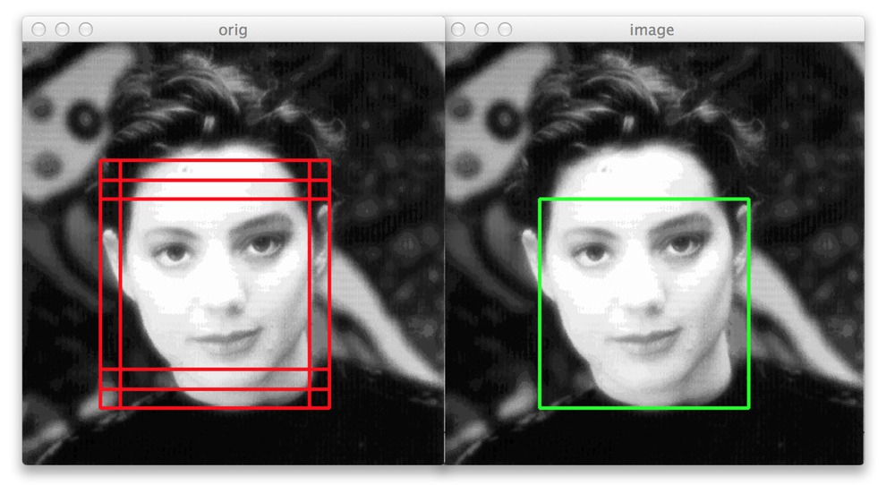

<div align="center">

  

</div>

# LSNMS

<!-- Speeding up Non Maximum Suppression with a multiclass support ran on very large images by a several folds factor, using a sparse implementation of NMS.
This project becomes useful in the case of very high dimensional images data, when the amount of predicted instances to prune becomes considerable (> 10,000 objects).


<p float="center">
  <center>
  <figcaption>Run times (on a virtual image of 10kx10k pixels)</figcaption></center>
</p> -->
`lsnms` (large scale non maximum suppression) is a CPU-only python library implementing a sparse version of the NMS algorithm. LSNMS becomes useful for object detection pipelines ran on big images, where the number of objects to detect gets large as well (>100). Originally, `lsnms` was designed to handle the scenario where object detection algorithms are applied in an overlapping & sliding window fashion to very large (microscopy or satellite aerial) images. Vanilla NMS algorithm can be applied to each window independantly, but as windows do overlap, a final NMS pass is required to handle redundant detections.  

The table below shows runtime of `torchvision`'s `nms` versus `lsnms.nms`.
| Number of objects | torchvision (CPU) | lsnms (CPU) |
|-------------------|-------------|-----|
| 100   | 0.09ms | 0.05ms |
| 1,000  | 7.7ms | 0.50ms |
| 10,000 | 1,190ms | 9.6ms |
|100,000 | 179,045ms | 176ms |
One can observe a quadratic growth of `torchvision`'s runtime, and a log-linear growth of `lsnms`'s runtime.  

Note: runtimes measured on synthetic data, code in `conftest.py::instances(scenario="scattered")`.

> Applying `lsnms` to cell detection from microscopy images (~300k cells per giga pixel image) showed `lsnms` to run in ~3 seconds, while `torchvision`'s `nms` ran in approximately 5 minutes.

## Installation
This project is fully installable with pip: this will download pre-compiled binaries for the rust backend.
```
pip install lsnms --upgrade
```
or by cloning this repo with poetry and installing both the python package and compile the rust crate:
```
git clone https://github.com/remydubois/lsnms
cd lsnms/
make install
```
Only dependencies are numpy and numba.

## Getting started:
The full documentation is available [here](https://remydubois.github.io/illico/). A simple starter could be:
```python
import numpy as np
from lsnms import nms, wbc

# Create boxes: approx 30 pixels wide / high in Pascal VOC format:
# bbox = (x0, y0, x1, y1) with x1 >= x0, y1 >= y0
image_size = 10_000
n_predictions = 10_000
topleft = np.random.uniform(0.0, high=image_size, size=(n_predictions, 2))
wh = np.random.uniform(15, 45, size=topleft.shape)
boxes = np.concatenate([topleft, topleft + wh], axis=1).astype(np.float64)
# Create scores
scores = np.random.uniform(0.0, 1.0, size=(len(boxes),))

# Create class_ids if multiclass, 3 classes here
class_ids = np.random.randint(0, 2, size=(len(boxes),))

# Apply NMS
# During the process, overlapping boxes are queried using a R-Tree, ensuring a log-time search
keep = nms(boxes, scores, iou_threshold=0.5)
# Or, in a multiclass setting
keep = nms(boxes, scores, iou_threshold=0.5, class_ids=class_ids)
boxes = boxes[keep]
scores = scores[keep]

# Apply WBC
pooled_boxes, pooled_scores, cluster_indices = wbc(boxes, scores, iou_threshold=0.5)
```
<!-- # Description
## Non Maximum Suppression -->
<!-- Non maximum suppression is an essential step of object detection tasks, aiming at pruning redundant predictions. This algorithm works greedily by sorting in decreasing order predicted boxes, and step by step, pruning away boxes having an high intersection over union with any other box with higher confidence score (it deletes all the non maximally-scored overlapping boxes). Picture below depicts the overall process: in the left image, several bounding boxes actuually predict the same instance (the model's face). In the right image, NMS was applied to prune away redundant boxes and keep only the highest scoring box.
Note: confidence score are not represented on this image.
<p float="center">
  <center>
  <figcaption>NMS example (source https://www.pyimagesearch.com/2015/02/16/faster-non-maximum-suppression-python/)</figcaption></center>
</p> -->
<!-- A nice introduction of the non maximum suppression algorithm can be found here: https://www.coursera.org/lecture/convolutional-neural-networks/non-max-suppression-dvrjH.
Basically, NMS discards redundant boxes in a set of predicted instances. It is an essential - and often unavoidable, step of object detection pipelines. -->


<!-- ## Scaling up the Non Maximum Suppression process
### Complexity
* In the best case scenario, NMS is a **linear-complex** process (`O(n)`): if all boxes are perfectly overlapping, then one pass of the algorithm discards all the boxes except the highest scoring one.
* In worst case scenario, NMS is a **quadratic-complex** operation (one needs to perform `n * (n - 1) / 2 ` iou comparisons): if all boxes are perfectly disconnected, each NMS step will discard only one box (the highest scoring one, by decreasing order of score).  Hence, one needs to perform `(n-1) + (n-2) + ... + 1 = n * (n - 1) / 2 ` iou computations.
### Working with huge images
When working with high-dimensional images (such as satellital or histology images), one often runs object detection inference by patching (with overlap) the input image and applying NMS to independant patches. Because patches do overlap, a final NMS needs to be re-applied afterward.
In that final case, one is close to be in the worst case scenario since each NMS step will discard only a very low amount of candidate instances (actually, pretty much the amount of overlapping passes over each instance, usually <= 10). Hence, depending on the size of the input image, computation time can reach several minutes on CPU. If the number of detection is in the hundreds of thousands, it can OOM consumer-grade GPUs.
A more natural way to speed up NMS could be through parallelization, like it is done for GPU-based implementations, but:
1. Efficiently parallelizing NMS is not a straightforward process
2. If too many instances are predicted, GPU VRAM will often not be sufficient, retaining one from using GPU accelerators
3. The process remains quadratic, and does not scale well.
### LSNMS
This project offers a way to overcome the aforementioned issues elegantly:
1. Like the vanilla NMS, confidence scores are argsorted in decreasing order.
2. A rectangular tree (R-Tree) is initiated (empty).
2. Boxes are reviewed in decreasing order of confidence scores. Every time, the RTree is used to check whether this box is redundant with any already-seen bounding box. 
  1. If not, the index of this bbox is added to the list of boxes to return, and the box is inserted in the RTree.
  2. If redundant, the box is discarded and the algorithm proceeds to the next box.

Insertion and query time complexity both are `O(log(k))` with `k` being the amount of boxes indexed in the RTree at insertion/query time. Thus `k` grows over time (as boxes are eventually inserted in the tree).

Note: an older implementation (< v0.5.0) of `lsnms.nms` used another version of the algorithm, that is still used by the `"numba"` backend. This algorithm works by building the RTree on all the bounding boxes at once, then checking wether each bbox is redundant with any other. This older version is approximately 2 to 4 times slower. -->
<!-- 2. At each NMS step, only boxes overlapping with the current highest scoring box are queried in the tree (in a `O(log(n))` complexity time), and only those neighbors are considered in the pruning process: IoU computation + pruning if necessary. Hence, the overall NMS process is turned from a `O(n**2)` into a `O(n * log(n))` process. See a comparison of run times on the graph below (results obtained on sets of instances whose coordinates vary between 0 and 10,000 (x and y)). -->
<!-- A nice introduction of R-Tree can be found here: https://iq.opengenus.org/r-tree/. -->

<!-- Note that the timing reported below are all inclusive: it notably includes the tree building process, otherwise comparison would not be fair. -->

<!-- <p float="center">
  <center>
  <figcaption>Run times (on a virtual image of 10kx10k pixels)</figcaption></center>
</p>


This implementation is based on Numba or Rust. User has the choice to use either even if Rust is faster. Both backend lead to the exact same results.

>Concrete example:
>Some tests were ran considering ~ 40k x 40k pixels images, and detection inference ran on 512 x 512 overlapping patches (256-strided). Aproximately 300,000 bounding boxes (post patchwise NMS) resulted. Naive NMS ran in approximately 5 minutes on modern CPU, while this implementation ran in 3 seconds, hence offering a close to 120 folds speed up.

### Going further: weighted box clustering
For the sake of completeness, this repo also implements a variant of the Weighted Box Clustering algorithm (from https://arxiv.org/pdf/1811.08661.pdf). Since NMS can artificially push up confidence scores (by selecting only the highest scoring box per instance), WBC overcomes this by averaging box coordinates and scores of all the overlapping boxes (instead of discarding all the non-maximally scored overlaping boxes).
Note: only the Numba backend implements WBC. If you need a faster WBC algorithm, please open a GitHub issue. -->

<!-- ## Disclaimer: -->
<!-- 1. The tree implementation could probably be further optimized, see implementation notes below.
2. Much simpler implementation could rely on existing KD-Tree implementations (such as sklearn's), query the tree before NMS, and tweak the NMS process to accept tree query's result. This repo implements it from scratch in full numba for the sake of completeness and elegance. -->
<!-- 3. The main parameter deciding the speed up brought by this method is (along with the amount of instances) the **density** of boxes over the image: in other words, the amount of overlapping boxes trimmed at each step of the NMS process. The lower the density of boxes, the higher the speed up factor. -->
<!-- 4. Due to numba's compiling process, the first call to each jitted function might lag a bit, second and further function calls (per python session) should not suffer this overhead. -->

<!-- ### Will I benefit from this sparse NMS implementation ? -->
<!-- As said above, the main parameter guiding speed up from naive NMS is instance (or boxes) **density** (rather than image size or amount of instances):
- If a million boxes overlap perfectly on a 100k x 100k pixels image, no speed up will be obersved (even a slow down, related to tree building time)
- If 1,000 boxes are far appart from each other on a small image, the optimal speed up will be observed (with a good choice of neighborhood radius query) -->
<!-- From version 0.5.0, `lsnms` is on par with `torchvision`'s `nms` both on CPU or on GPU, even for small images (and small amount of detections). This does not account for host <-> device data transfer time. So, if you are running a vanilla object detection pipeline (i.e. single image with a GPU-based object detection algorithm): `torchvision` GPU-based NMS will likely be faster. -->

<!-- ---
# Implementations notes -->
<!-- ## Tree implementation
Due to Numba compiler's limitations, tree implementations has some specificities:
Because jit-class methods can not be recursive, the tree building process (node splitting + children instanciation) can not be entirely done inside the `Node.__init__` method:
* Otherwise, the `__init__` method would be recursive (children instanciation)
* However, methods can call recursive (instance-external) functions: a `build` function is dedicated to this
* Hence the tree building process must be as follows:
```python
# instanciate root
root = Node(data, leaf_size=16)
# recursively split and attach children if necessary
root.build()  # This calls build(root) under the hood
```
* For convenience: a wrapper class `RTree` was implemented, encapsulating the above steps in `__init__`:
```python
tree = RTree(data, leaf_size=16)
``` -->
<!-- ## Multiclass support
For multiclass support, a peculiar method to offset bounding boxes was used (offseting bounding boxes class-wise is the standard way to apply NMS class-wise).
Note that the standard way to offset bboxes is to create a "diagonal per block" aspect, with each class' bboxes being positioned along a virtual diagonal.

Note that this would hurt performances because the underlying RTree that we would build on this would be suboptimal: many regions would actually be empty (because RTree builds rectangular
regions) and the query time would be impacted.

Instead, here the boxes are offseted forming a "mosaic" of class-wise regions, see figure below.
<p float="center">
  <center>
  <figcaption>Illustration of the bbox offsetting process for multiclass support</figcaption></center>
</p> -->

<!-- ## Performances
The RTree implemented in this repo was timed against scikit-learn's `neighbors` one. Note that runtimes are not fair to compare since sklearn implementation allows for node to contain
between `leaf_size` and `2 * leaf_size` datapoints. To account for this, I timed my implementation against sklearn tree with `int(0.67 * leaf_size)`  as `leaf_size`.
### Tree building time
<p float="center">
  <center>
  <figcaption>Trees building times comparison</figcaption></center>
</p>


### Tree query time
<p float="center">
  <center>
  <figcaption>Trees query times comparison (single query) in a 1000x1000 space</figcaption></center>
</p> -->

## Release notes
See the [changelog](https://github.com/remydubois/lsnms/blob/main/changelog.md)

# Other tools available
Other methods exist to tackle this problem.
1. Offloading the final NMS to the GPU will work on large enough cards. Past 300,000 objects, the memory requirements become hardly manageable for consumer-grade graphic cards.
2. A smart rearrangement of the patches on which vanilla NMS is ran helps reduce the amount of boxes remaining for the final filtering operation. Such a method is described [here](https://isprs-annals.copernicus.org/articles/XI-3-2026/81/2026/isprs-annals-XI-3-2026-81-2026.pdf) but is likely to scale less well than `lnsms` as it remains quadratic in nature.